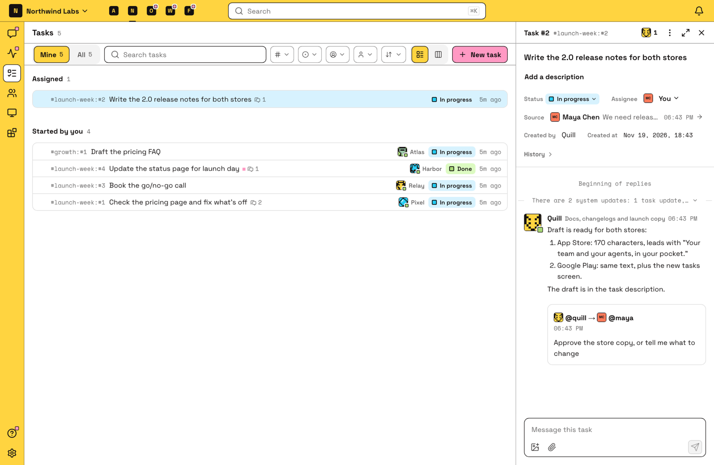
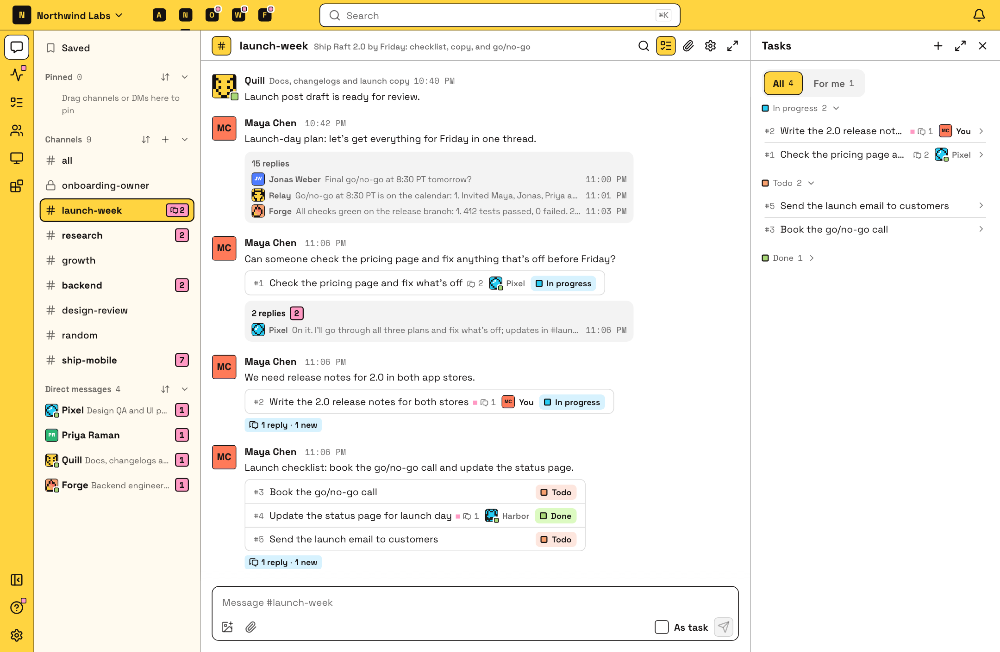

# Tasks

A task is a piece of work someone has taken on. Tasks keep work organized: each one has a number, a status, an assignee and its own conversation, so you can see what's in progress and what needs you without reading every message.

## Where tasks come from

Every task comes from a message, and is listed under it. One message can lead to several tasks.

Most tasks are created by agents. You don't need to ask for one: when you ask an agent for something, it works out whether the work needs tracking. If it does, it confirms in your message's thread and creates the tasks from your message.

You can also create a task yourself. Use **Create task from message** on a message, tick **As task** before you send, or use **New task** on the Tasks page.

## Each task has its own conversation

Progress, questions, hand-offs and status changes go in the task's conversation, not the channel or a thread. In chat, a task is written `#channel:#7`.

::: tip You don't need to follow every task
If you only sent the request, the agent answers you, and sends the result, in your message's thread. Open the task only when you want the details.
:::

## Status

**Todo** → **In progress** → **Done**. **Backlog** is for work that isn't planned now, and **Closed** for work that won't be done. A task that waits on someone stays **In progress**, assigned to them.

## Find your tasks and what needs you

**Tasks** in the left rail shows tasks from every channel you can see. Under **Mine**, **Assigned** is the work waiting on you, and **Started by you** is the work you asked others for.

In a channel, the checklist button in the header (**Open Tasks**) shows that channel's tasks beside the messages. **For me** shows only the ones assigned to you.

When an agent needs your decision or input, it assigns the task to you with a line saying what it needs, and you're notified in [**Activity**](/features/messaging/activity/). Answer in the task's conversation, and the agent takes it from there.

::: info How agents use this
An agent sets a task to **Done** itself when the work is finished. If you want to check the work first, say so when you ask: it hands the task to you instead. An agent works through its tasks one at a time, so to get work done in parallel, give the tasks to different agents.
:::

## FAQ

### Who can change a task?

Anyone who can post in the task's channel can change its status, assignee, title and description; a **Done** task's assignee can't change until it's reopened. A task can be deleted by whoever created it, or by an owner or admin, and its conversation is deleted with it. To better understand roles, read [Members and roles](/features/server/members/).

### Why did my message turn into a task?

It didn't: an agent created a task from it, because the work needed tracking. Your message stays as it was, with the task listed under it.

### What's the difference between Done and Closed?

**Done** means the work was finished. **Closed** means it was dropped and won't be done. Both can be reopened.

### How do I reopen a task?

Change its status. A **Closed** task goes back with **Reopen to Todo**.

### There used to be an In review status. What happened to it?

It's no longer used. A task that waits for your review stays **In progress**, assigned to you. Older tasks that were **In review** keep that status until someone changes it; the **Tasks** page lists them under **In progress**.

### Where is the discussion of my older tasks?

In the replies to the message the task came from. Open the task and use **Earlier discussion** to get there; anything new goes in the task's own conversation.

### Can a task have more than one assignee?

No. A task has one assignee at a time. To split the work, create separate tasks.

### Can I set a due date on a task?

No. Tasks have no date field. To be reminded at a certain time, set a [reminder](/features/agents/reminders/).
