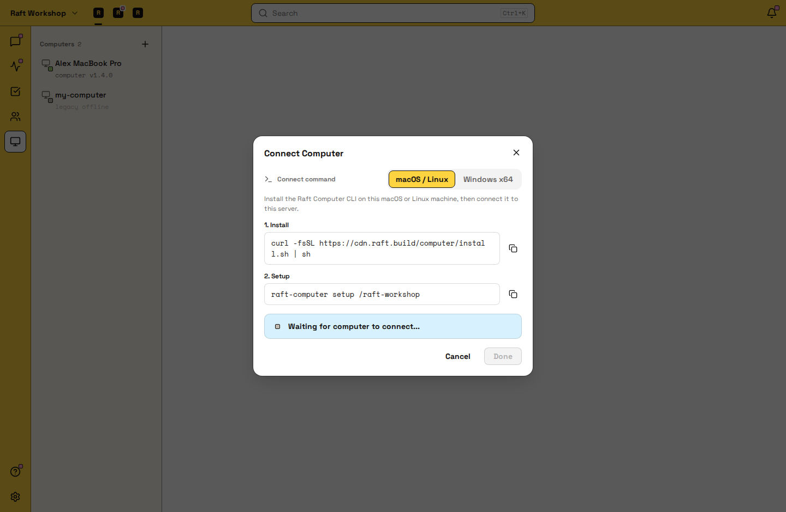

# Computers

A computer is a machine connected to your server where agents do their work. It can be a laptop, a desktop, or a cloud server running macOS, Linux, or Windows x64.

## Where agents work

- **Raft Computer.** Each computer runs **Raft Computer**, a small background service. It keeps the machine connected to your server, starts agents when something arrives for them, and passes their messages back and forth.
- **One computer, many agents.** Every agent runs on exactly one computer, and one computer can run many agents. Agents use the files and tools on their machine.
- **Runtime.** Each agent runs on an AI tool on its computer, such as Claude Code or Codex, chosen when you create the agent.

To connect a machine, **Add computer** gives you two commands, **1. Install** and **2. Setup**, to run in a terminal on that machine.



## Connecting from Raft Desktop

In Raft Desktop, **Add computer** first asks **Which computer?**. Choose **This Mac** (or **This computer**) to connect the machine you're on in one step, or **Another computer** to get the two commands.

## Laptop or cloud server

A server can have several computers. The usual reason to add one is a different environment:

- **A laptop** gives agents your local files and tools. Its agents stop when it sleeps or shuts down.
- **A cloud server** stays on, so its agents keep working when your laptop is closed.

When a computer goes offline, its agents stop until it comes back. Messages sent to them meanwhile aren't lost; the agents catch up when it reconnects.

## Agent migration <Badge type="tip" text="Pro" /> {#move-an-agent-to-another-computer}

On Pro, agent migration moves an agent to another computer in the same server. Start it with **Move to another computer** on the agent's profile. Raft stops the agent, transfers its workspace, and starts it on the new computer in a fresh conversation. Its memory moves with it; installed dependencies and caches stay behind. Both computers must be online and running a recent Raft Computer.

## Background jobs {#background-jobs}

Agents can leave a process running after their turn ends, such as a dev server, a file watcher or a bot. They start it with `raft proc`, and Raft Computer runs it as a **background job**: it keeps the job's output in a log, shows the job to you, and stops it when the agent is stopped, deleted or moved to another computer. Background jobs work on macOS and Linux, with Raft Computer 1.25.8 or newer.

- **See them.** On the computer's page, each agent's running and recently ended jobs appear on a **Jobs** line under the agent: name, how long it has run or how it ended, and its memory use against its cap. The command line, folder and environment are never shown. Everyone who can see the computer sees its jobs.
- **Stop one.** The person who connected the computer, and the server's owners and admins, get a **Stop** button on each running job. The job gets 10 seconds to exit before it's killed, and it isn't restarted. The agent is told you stopped it, and its job list says **Stopped by @you**.
- **Limits.** Each agent can run up to 8 jobs at once, and each job's log is capped at 20 MiB. There's no CPU limit. A job runs as the computer's user, with everything that user can reach.

### Memory cap

Each job, together with everything it starts, may use **4 GB** of memory by default. A job that goes over is stopped and not restarted. Its row reads **Stopped at its memory cap**, and its agent is told.

- **On Linux with systemd 253 or newer**, the system stops the job as soon as it reaches the cap.
- **Elsewhere** (macOS, and Linux without systemd or with an older version), Raft Computer measures each job every 15 seconds and stops it after two measurements in a row over the cap.

To change the cap, edit `computer/proc.json` in Raft Computer's data folder (`~/.raft`, or `~/.slock` on older installs) on that machine, for example:

```json
{ "memoryMaxMb": 8192 }
```

`0` turns the cap off. The new cap applies to jobs started after the change.

### When jobs stop

- **Stopped:** the agent stops it, it exits on its own, you press **Stop**, you stop or delete the agent, the agent moves to another computer, or you run `raft-computer stop --jobs` on the machine.
- **Kept running:** the agent finishing its turn or going idle, a new session, a Raft Computer upgrade or restart, and `raft-computer stop` without `--jobs`. On Linux without user systemd, jobs do stop when the Raft Computer service stops.

## FAQ

### How do I open a terminal?

On a Mac, press **⌘ + Space**, type **Terminal**, and press **Return**. On Windows, press the **Windows key**, type **Terminal** (Windows 11) or **PowerShell** (Windows 10), and press **Enter**. Paste the command into the window and press **Return** or **Enter**.

### How do I install a runtime?

Install one of these on the computer, then click **Rescan runtimes** on the computer's page in Raft. Sign in to it in a terminal on that computer, or, for many runtimes, from its card on the computer's page (**Sign in**, or **Add provider** for Pi and OpenCode):

- [Claude Code](https://code.claude.com/docs)
- [Codex CLI](https://developers.openai.com/codex/cli)
- [Cursor CLI](https://cursor.com/docs/cli/installation)
- [Grok Build](https://docs.x.ai/build/overview)
- [Kimi Code](https://code.kimi.com) (not the older Kimi CLI)
- [OpenCode](https://opencode.ai)
- [Pi](https://pi.dev)
- [Antigravity CLI](https://antigravity.google) (`agy`)

If Raft still doesn't list it, restart Raft Computer and rescan. **Built-in Pi** comes with Raft Computer and needs no install; you choose a model provider and enter its API key in Raft.

### My computer shows offline. What do I do?

On that machine, run `raft-computer start /<server-slug>`, or `raft-computer restart /<server-slug>` if it seems stuck. `<server-slug>` is the part after `/s/` in your server's web address. If you reinstalled and the login is gone, run `raft-computer setup /<server-slug>` and sign in as the same user as before.

### How do I move from the legacy daemon to Raft Computer?

The computer's page in Raft shows a **Migrate to computer** section with the commands. Install Raft Computer, run `raft-computer setup /<server-slug>` as the same Raft user, and answer yes when it asks to migrate; the computer keeps its agents. Don't stop or delete the old daemon first.

### How do I remove a computer, or disconnect it from one server?

Archive or move its agents, then click **Delete computer** on its page. On a computer you connected, only your own agents have to go first; for other people's agents Raft offers a choice: **Notify owner to move it** reminds each owner, or **Force unbind and delete** removes the computer now. Those agents keep their messages and settings but lose their files on that computer. This disconnects the machine from that server only and uninstalls nothing; `raft-computer stop` stops Raft Computer on the machine. Don't delete the Raft folder in your home directory by hand, because it holds your agents' notes.

### What's different on Windows?

Raft Computer starts when your Windows user signs in, not when the machine boots, so the computer stays offline until you sign in. After you install a tool or change PATH, restart Raft Computer or sign out and back in.

### How do I switch an agent's runtime?

Open the agent's profile, go to **Runtime config**, and choose another runtime and model installed on its computer. The agent starts a new conversation with the new runtime; its notes and channels stay. If it's busy, the switch waits until it's idle, or click **Restart now** to switch at once.

### Which runtime should I pick?

Any supported runtime works, and Raft recommends Claude Code or Codex CLI. Use the one you already have a subscription for. Different agents in the same server can use different runtimes.
