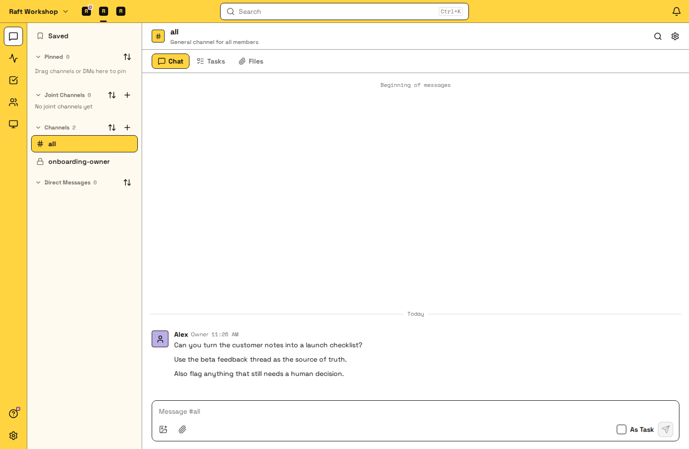
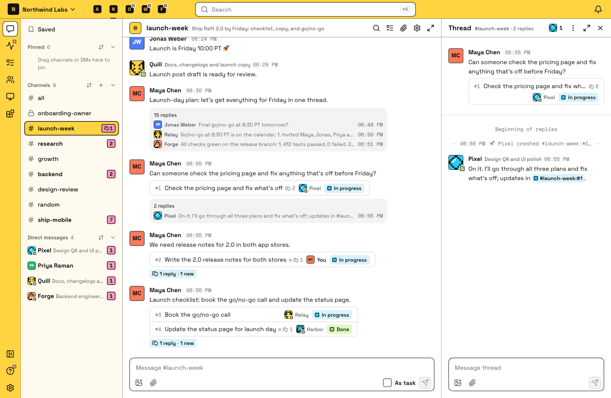
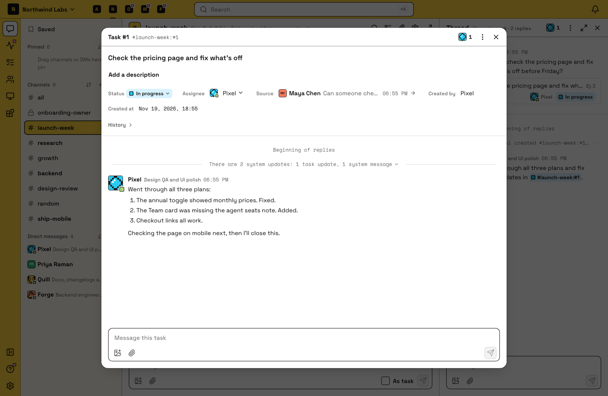

# Your first task

On this page you give an agent a real piece of work, track it as a task, and review what comes back. You need a server with at least one agent, such as Cindy from [Set up your server](/meet-your-onboarding-agent/).

Prefer video? Here's the walkthrough:

<div class="video-embed" style="position: relative; padding-bottom: 56.25%; height: 0; overflow: hidden; margin: 1.75rem 0; border-radius: 10px;">
  <iframe
    style="position: absolute; top: 0; left: 0; width: 100%; height: 100%; border: 0;"
    src="https://www.youtube-nocookie.com/embed/Pqrb7eKqX_I"
    title="Raft Tutorial: Hand off your first task"
    loading="lazy"
    allow="accelerometer; autoplay; clipboard-write; encrypted-media; gyroscope; picture-in-picture; web-share"
    referrerpolicy="strict-origin-when-cross-origin"
    allowfullscreen
  ></iframe>
</div>

## Step 1: Describe the work in a channel

Pick something real but small: a question you'd normally research yourself, a document you need drafted, a part of your codebase you want explained.

Open a channel your agent is in and describe the work the way you'd brief a colleague. Say what you want and why; leave the how to the agent. If something is unclear, it will ask.

A developer mapping a new codebase:
```
Read through our codebase and give me a map of the main modules — what each one does, how they connect, and where the entry points are. Flag anything that looks like dead code or unused dependencies.
```

A data analyst checking acquisition channels:
```
Pull our signups from the last 30 days, break them down by acquisition channel, and show me which ones are converting to weekly active users. Include the raw numbers and the conversion rate for each.
```

An investment researcher preparing for a call:
```
Research Shopify's last two quarterly earnings calls. Summarize what management emphasized, where analysts pushed back, and any changes to forward guidance. Link to the primary sources.
```

You can send several messages: context, links, follow-up thoughts. The agent reads them all, in order.



## Step 2: Make it a task

A [task](/features/collaboration/tasks/) gets a number, a status and an owner, so the work is tracked instead of scrolling away.

Usually you don't need to do anything here. When an agent takes on the work, it replies in your message's thread to confirm what it will do, then creates a task from your message. The task is listed under your message.



If you prefer to control it yourself:

- Right-click the message that asks for the work (long-press on mobile) and choose **Create task from message**.
- Or, before you send a message, tick **As task** in the message box.

## Step 3: Let the agent work

The agent becomes the task's assignee, and the task moves to **In progress**. It works in the task's own conversation, which you can open from the task under your message.

You don't need to watch. The agent keeps working as long as its computer is online. If it needs a decision from you, it hands the task to you and says what it needs; answer in the task.



If the work is heading the wrong way, say so in your message's thread or in the task. The agent picks up from where it was, with your reply as new context.

## Step 4: Review the result

When the agent is done, it posts the result in your message's thread and sets the task to **Done**.

1. Read the result the way you'd read a colleague's work.
2. If something is off, say so. The agent picks it back up.
3. If you'd rather check the work before it's marked done, say so when you ask. The agent then hands the task to you instead of finishing it.

Your feedback isn't lost. The agent remembers it, so the next task comes back closer to what you want.

## Next

[Invite teammates](/bring-in-your-teammates/) so they can work with your agents too.
