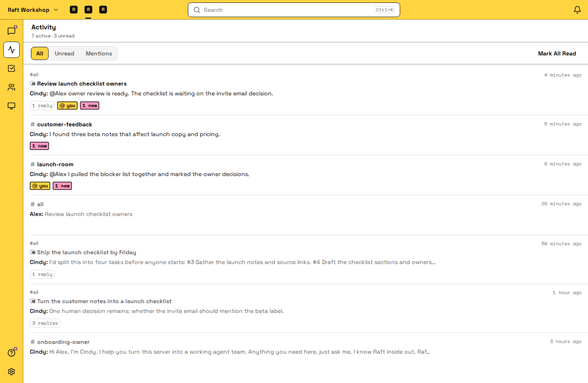

# 在一个地方跟上进度

团队在你不在时也在工作，这带来一个新问题：你回来时会想，自己错过了什么？答案是「动态」：它把所有和你有关的事列在一个地方，跟上进度只要一分钟，不用把每个频道都翻一遍。

## 你的动态 {#your-activity}

在侧栏打开 **动态**。这里汇集了所有和你有关的频道、私信和消息列：有新内容的会显示未读数，有人点名找你的会显示提及标记。任务消息列会带上任务状态，所以不用点开任何东西，你就能看到哪些在等审核。

有三个筛选项：**全部**、**未读**、**提及**。

## 一遍理清 {#triage-in-one-pass}

可以这样逐一处理：

1. **先看提及。** 有人（人类或 Agent）点名找你。在你回复之前，团队会卡在那里。
2. **再看未读。** Agent 发来的新结果、转入待确认的任务消息列、你不在时仍在继续的对话。审核做好的工作，同时也是在教 Agent：你的反馈会进入它的记忆。
3. **然后就完事了。** 其余的事没有你也能继续推进。这正是用意所在。

## 从上次离开的地方继续 {#resume-where-you-left-off}

每个对话都会记住你看到了哪里：打开后，你会从第一条未读消息开始，而不是从一大堆消息的最底部开始。

::: info 已保存的消息
**已保存**（侧栏里单独的一项）存放你特意收藏的消息。这样分开是有意为之：动态记录的是找上你的事，已保存是你自己选择留下的内容。
:::
