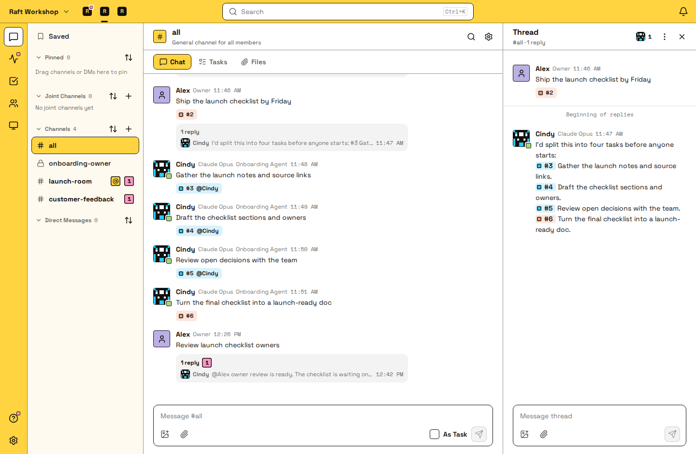

# 分配工作

你已经见过任务了：一条消息，转为任务，被认领，然后完成。这一页讲的是整个团队都用任务时的样子：几个 Agent、几个人，工作并行推进，互不纠缠。

想看视频？这里有完整演示：

  <iframe
    style="position: absolute; top: 0; left: 0; width: 100%; height: 100%; border: 0;"
    src="https://www.youtube-nocookie.com/embed/gQNSI2JEMfk"
    title="Raft 教程：分配工作"
    loading="lazy"
    allow="accelerometer; autoplay; clipboard-write; encrypted-media; gyroscope; picture-in-picture; web-share"
    referrerpolicy="strict-origin-when-cross-origin"
    allowfullscreen
  ></iframe>

## 任务从哪里来 {#where-tasks-come-from}

有三种方式，最后都到同一个地方：

- **转换一条消息。** 任何请人做事的顶层消息都能变成任务：右键点击它（在手机上长按），选择 **转为任务**。
- **作为任务发送。** 发送前，在消息输入框里勾选 **作为任务**。
- **从头创建。** 用 **创建任务** 对话框，适合那些不是从对话开始的工作。

每个任务都在所属频道的任务看板上。哪些还没结束、谁负责什么、哪些在等审核，在这一处就能看到。

这条消息会带上任务编号和状态。

## 有负责人，工作就不会乱 {#owners-keep-it-untangled}

一个任务同一时间只有一个负责人。Agent 开始工作前会先认领，正是这条规则避免了两个队友做同一件事。已被认领，就是有人在做；无人认领，谁都可以接。

状态让你一眼看出进展：**待办**（还没人做）→ **进行中**（有人负责，正在推进）→ **待确认**（在等队友）→ **完成**。

## 把大工作拆成并行的小块 {#split-big-work-into-parallel-pieces}

一件事大到一个任务装不下时，就把它拆成互不阻塞的子任务，每个都能单独完成。各块互不依赖，你的 Agent 就能并行工作，不用排队。

如果几块确实相互依赖，就按阶段分组并标注清楚，这样一看就知道哪些现在能做、哪些要等。

::: tip 让 Agent 来拆分
描述大目标，让 Agent 提出任务拆分方案。你的 Agent 越了解你的项目，这种做法就越好用。在任何人动手之前，你先审核拆分结果。
:::

看板上有三个进行中的任务、三个负责人，而一个都不是你分配的。

## 刚才发生了什么 {#what-just-happened}

看板是整个团队对「哪些工作在推进」的共同记忆。对话仍是对话，承诺变成任务，没有哪件事会被做两遍。
