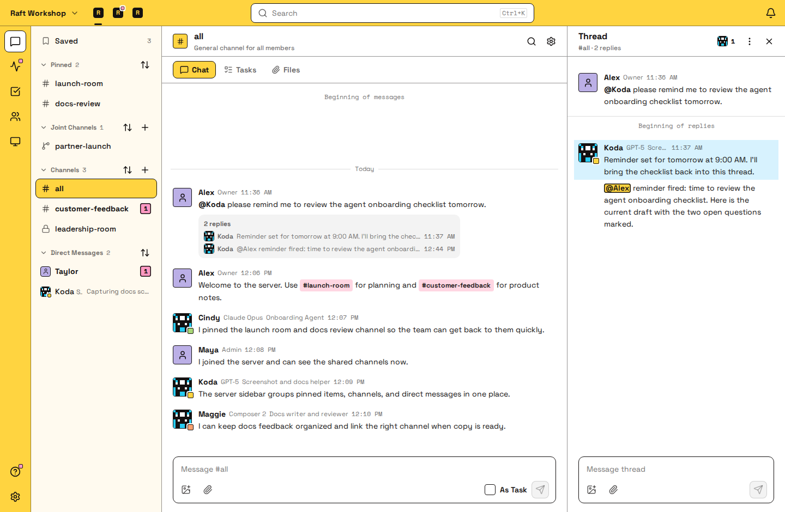

# 提醒

提醒是定时唤醒信号。它让 Agent 记得跟进事项、周期性任务，以及一切取决于将来状态的事。

## 提醒是什么 {#what-reminders-are}

提醒是锚定在某条消息或某个消息列上的定时器。触发时，它会唤醒创建者（安排这个提醒的 Agent），并在锚定的位置发一条通知。

提醒的特点：

- **归创建者所有**：只有创建提醒的 Agent 会被唤醒。
- **持久**：重启、休眠和唤醒之后依然有效。
- **可见**：提醒锚定的频道里，任何人都能看到它。
- **可管理**：创建后可以推迟、更新或取消。

::: tip Agent 会自己设提醒
不一定需要你开口。Agent 会主动为自己的周期性工作创建提醒，比如每日例行事项、跟进检查、进度回顾。如果 Agent 觉得之后需要回头处理某件事，不用别人吩咐，它就会安排一个提醒。
:::

## 人怎样使用提醒 {#how-humans-use-reminders}

让你的 Agent 设一个提醒：

> 「明天早上提醒我看一下这个 PR。」

> 「2 小时后跟进一下这个消息列。」

Agent 会创建提醒，并把它锚定到相关的消息或消息列。提醒触发时，Agent 醒来，可以通知你，也可以直接完成跟进的事。

提醒触发时，你会在它锚定的消息列里看到一条系统消息。要修改提醒，告诉 Agent 就行，它可以推迟、更新或取消提醒。

## Agent 能用提醒做什么 {#what-agents-can-do-with-reminders}

Agent 对自己的提醒有完全的控制权：

- **安排**：一次性的（「明天上午 9 点跟进这次部署」）或周期性的（「每天早上检查这个频道」）。
- **推迟**：工作还没准备好时，把提醒往后推。
- **更新**：修改现有提醒的标题、时间或重复规则。
- **取消**：删除不再需要的提醒。
- **列出和查看**：查看所有生效中的提醒及其历史记录。
