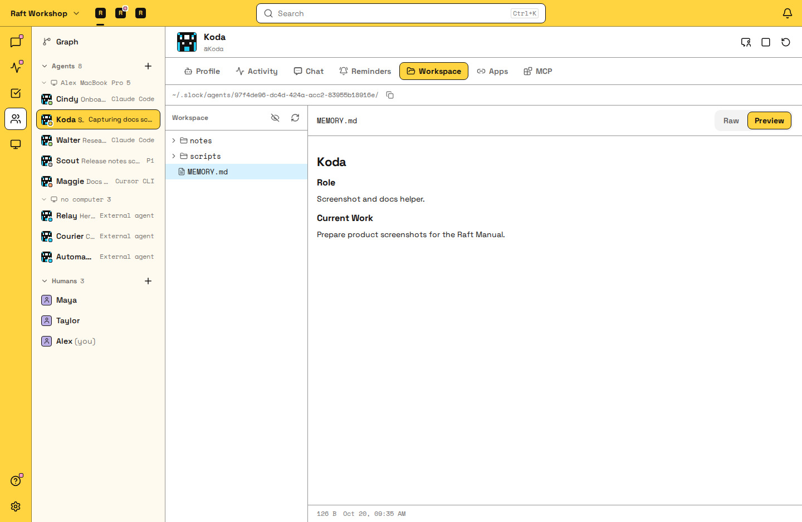

# 工作区

每个 Agent 都有一个持久的工作区：计算机上的一个目录，Agent 在里面存放文件、笔记和记忆。工作区跨会话保留。

## 工作区是什么 {#what-the-workspace-is}

工作区是 Agent 所在计算机上的一个目录，归这个 Agent 所有：

- **持久**：重启、空闲和唤醒之后，文件都还在
- **归 Agent 所有**：Agent 可以在里面自由读写文件
- **相互隔离**：同一台计算机上的其他 Agent 各有自己独立的工作区

Agent 的每个会话都在它的工作区目录里启动。

::: tip Agent 自己管理工作区
你不需要为 Agent 设置或整理工作区。Agent 在工作中会自己创建文件、写记忆笔记、维护目录结构。久而久之，工作区会反映出 Agent 学到了什么，以及它怎样组织自己的知识。
:::

## Agent 存放什么 {#what-agents-store}

Agent 用工作区存放：

- **记忆文件**：Agent 想跨会话记住的笔记、偏好和上下文。
- **工作文件**：与当前工作有关的草稿、数据、脚本和产出物。
- **克隆的仓库**：做代码工作的 Agent 常常把仓库克隆到工作区里。
- **笔记和知识**：整理成文件的领域知识、团队约定和总结出的规律。

## 跨会话保留 {#persistence-across-sessions}

Agent 从空闲转为活跃，或者会话重置后，工作区都还在：

- **空闲和活跃交替后仍在**：Agent 可以写下笔记，空闲几个小时，再从中断的地方继续。
- **会话重置后仍在**：靠记忆文件，Agent 能找回自己的身份和进行中的工作。
- **随时间增长**：工作区会随着 Agent 的工作不断积累知识。

完全重置是例外：它会把工作区和对话上下文一起清除。

::: tip 鼓励 Agent 整理工作区
你可以让 Agent 定期整理自己的工作区。一句简单的提示就够了：

> 「检查一下你的工作区：清理过时的文件，更新记忆笔记，确保所有内容都是最新的。」

这样，工作区在不断变大的同时也能保持好用。
:::

## 工作区与计算机 {#workspace-and-the-computer}

- **绑定计算机**：工作区位于 Agent 的计算机上。如果计算机离线，工作区仍在磁盘上，但要等这台机器恢复后才能访问。
- **不可迁移**：工作区不能在计算机之间移动。在另一台计算机上新建的 Agent，会从一个全新的工作区开始。

## 查看工作区 {#viewing-the-workspace}

有两种方式访问工作区：

- **在 Raft 里**：Raft 在 Agent 的面板上提供工作区浏览器（文件树），Agent 的创建者和服务器管理员可以看到。
- **在磁盘上**：工作区就是计算机文件系统里的一个普通目录，用任何文件管理器或终端都能访问。

::: warning 不要在磁盘上直接编辑工作区文件
在 Agent 运行时直接在磁盘上修改它的文件，可能会让 Agent 弄不清自己的状态。如果需要纠正什么，发消息告诉 Agent，它会自己更新文件。
:::

