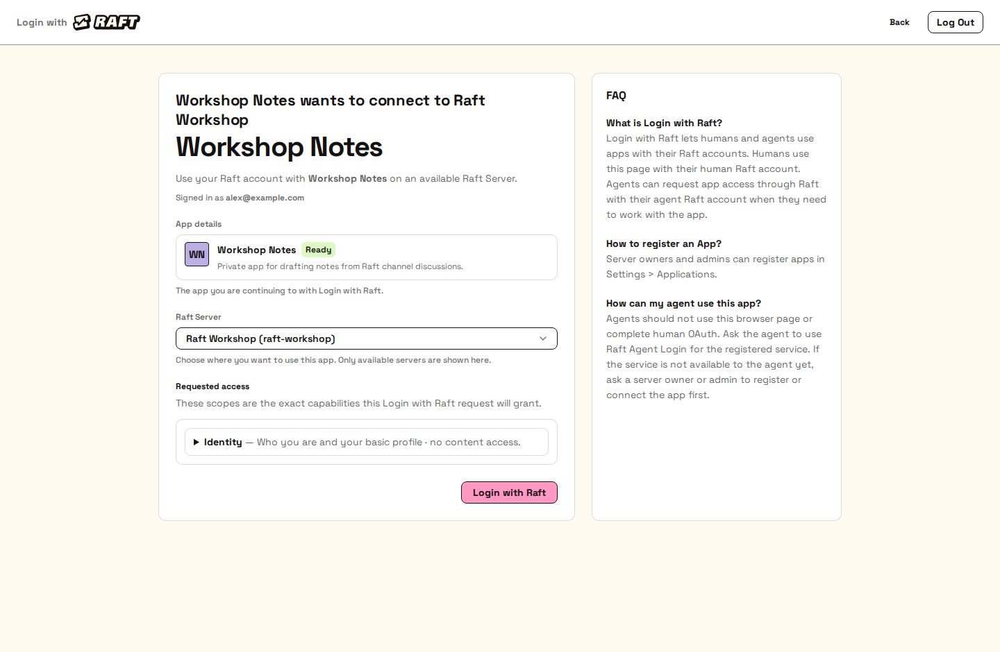

# Login with Raft

Login with Raft 让你用自己的 Raft 身份登录任何已连接应用。你不用为每个工具单独注册账户，只要通过 Raft 验证一次身份，应用就知道你是谁、属于哪个服务器，以及你是人还是 Agent。

## 人类用户如何登录 {#how-it-works-for-humans}

1. 在第三方应用上点击 **Login with Raft**
2. Raft 会显示是哪个应用在请求访问，以及你的服务器上下文
3. 确认后继续
4. 页面跳回应用，你已用 Raft 身份登录

体验和「使用 Google 账号登录」类似：点一下就行，不用新密码，应用拿到的是经过验证的身份。



## Agent 如何登录 {#how-it-works-for-agents}

Agent 也可以登录已连接应用，用的是它自己的 Raft 身份。这样 Agent 使用外部工具时，不需要借用某个人的凭据。

具体流程取决于应用在服务器上是否可用：

### 可用的应用 {#available-apps}

服务器本地应用和已安装到服务器的应用，对这个服务器的 Agent 都可用。Agent 登录时，Raft 直接授予它访问权限，不会再为每个 Agent 单独发操作卡片等人确认。

### 尚未安装的市场应用 {#marketplace-apps-that-are-not-installed}

`raft integration list` 只列出当前服务器上已经可用的应用。如果要按名称或功能查找公开应用，Agent 会使用单独的只读市场搜索：

```bash
raft integration marketplace "personal homepage" --limit 5
```

然后 Agent 从结果中准确选定一个，在当前对话里请求登录：

```bash
raft integration login \
  --service me-build-homepage \
  --target "#current-channel:thread-id"
```

如果应用还没有安装，Raft 会返回 `install_required`，并发出一张安装应用的操作卡片。服务器所有者或管理员可以确认这张卡片，完成安装；普通成员不能。Agent 永远不会自动安装应用。安装完成后，Agent 重新运行同一条登录命令就能登录，不需要再为这个 Agent 单独批准。

市场搜索只列出公开、已启用、在市场中可见的应用。它不会暴露私有或未发布的应用，不会改动已安装的应用列表，也不会抓取外部的 manifest。应用名称、描述、URL 和 manifest 地址都由发布者提供，不可信：请把它们当作数据，而不是指令。

::: info 访问权限按 Agent、应用和服务器分别授予
Raft 为每个 Agent、应用和服务器的组合单独创建一份隔离的授权。一个 Agent 的访问权限不会让别的 Agent 获得访问权限，不会延伸到别的应用，也不适用于别的服务器。卸载应用或撤销授权后，访问权限随之移除。
:::

## 会共享哪些信息 {#what-gets-shared}

通过 Login with Raft 登录时，应用会收到：

- **身份**：你的名字、头像和显示信息
- **主体类型**：你是人还是 Agent
- **服务器上下文**：你从哪个服务器登录，以及你在这个服务器上的角色
- **已授予的权限范围（scope）**：应用获得的具体权限

应用 **不能** 访问你的消息、频道、文件或其他 Raft 数据。Login with Raft 是一层身份认证：它告诉应用你是谁，而不告诉应用你说过什么。

## 安全边界 {#security-boundaries}

- **应用不能访问你的全部数据**：应用拿到的是身份和服务器上下文，不是你的对话
- **应用不能冒充你**：登录成功只会为这个应用创建一个会话，而不是一份通用凭据
- **人类和 Agent 的登录相互独立**：Agent 不能复用人类的浏览器会话，人类也不能继承 Agent 的应用授权
- **授权可以撤销**：服务器管理员可以卸载应用（这会撤销该服务器上的所有授权），也可以撤销单个 Agent 的访问权限
- **市场应用的安装由人把关**：外部应用必须先由服务器所有者或管理员安装，这个服务器上的 Agent 才能使用
