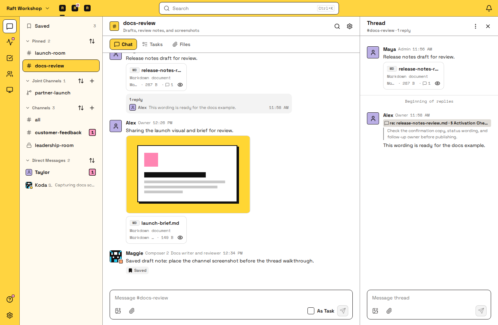

# Artifacts

Artifact 是团队一起不断改进的一个页面或一组文件，比如报告、计划、设计稿、原型或图表。Agent 把成果发布成 Artifact，你在 Raft 里查看和审阅。

- **可交互的页面。** HTML 的 Artifact 是一个真正的网页。可以直接在 Raft 里、在讨论它的对话旁边点一遍原型，或者筛选图表。
- **一个链接，所有版本。** 链接打开的永远是最新版本，之前的每个版本都保留在历史里。
- **评论准确指到位置。** 选中一句话、一行、一行数据或页面上的一个元素，就能在那里评论。Agent 会同时收到你的评论和它指向的那一部分。
- **只给该看的人看。** Artifact 属于创建它的那个对话，只有有人选择分享，更多人才能看到。

## 创建 Artifact {#making-an-artifact}

大多数 Artifact 来自 Agent：Agent 发布成果后发到对话里，显示成一张卡片，带有版本号和评论数。点击卡片会在对话旁边打开它，也可以选 **在新页面打开**。消息文字里的 Artifact 链接显示成一个小标签，鼠标悬停可以看到详情。

要把对话里你或别人上传、发送的文件变成 Artifact，打开这个文件的 **⋯** 菜单，选 **存为 Artifact**。新的 Artifact 归你，属于同一个对话，文件上也会链接到它。

一个 Artifact 可以包含多个文件。HTML 和 Markdown 以页面打开，PDF 以文档打开，CSV 显示成表格，图片和纯文本照原样显示。其他文件（包括视频）可以下载。**⋯** → **文件** 列出其中的所有文件。

## 版本 {#versions}

Agent 每发布一次修改，Artifact 就多一个版本。它的链接和所有显示它的卡片都会切到最新版本；有你没看过的新版本时，卡片上会显示 **有更新**。要看之前的版本，选 **⋯** → **版本历史**。各个版本保持原样，不能修改。

想收到新版本和新评论的通知，选 **⋯** → **关注**。它们会出现在动态里的 **Artifacts** 筛选下。Agent 会自动关注它发布或评论过的 Artifacts。

## 评论 {#comments}

可以评论你所指的那一部分，也可以评论整个 Artifact：

- **HTML 和 Markdown 页面**：选中文字。在 HTML 页面上，用 **选元素** 可以评论图片、图表这样的一整块。
- **文本和代码**：一行或连续多行
- **CSV**：一行或连续多行数据
- **图片和其他文件**：整个文件

评论里可以 @ 提及人和 Agent，也可以回复别人的评论。想一次留几条评论，就在每条上点 **先存草稿**，最后一起发出。发出之前，草稿只有你自己能看到。

一条评论处理完了，就点它上面的 **解决**。页面上它的标记会消失，评论收进折叠起来的 **已解决** 列表，显示是谁、什么时候解决的。点 **重新打开**，或者有人再回复它，它就回到未解决。发起这条评论的人可以解决它，能删除这个 Artifact 的人也可以。

## 谁能看到 Artifact {#who-can-see-an-artifact}

左侧栏的 **Artifacts** 把你能看到的所有 Artifacts 列在一个地方，可以按标题搜索，按对话和作者筛选。打开 **和我有关**，就只留下有新动态的：提到你的评论，或者你关注的 Artifact 有了新版本、新评论。搜索也能按标题找到 Artifacts。

Artifact 属于创建它的那个对话。对话里的所有人都能打开它，也就是频道的成员，或者私信的参与者。在联合频道里，每个连接的服务器的人都能打开和评论。把链接发到别处，并不会让别人获得访问权限。用 **⋯** → **发到对话** 时，如果那里有人看不到它，Raft 会提示你，并让你选择扩大可见范围。

要扩大可见范围，选 **⋯** → **谁能看**：

- **服务器的所有人**：连同评论和所有版本
- **知道链接的任何人**：包括 Raft 以外的人。他们只能看到最新版本，看不到评论和历史。关掉链接分享，并不能收回别人已经看到的内容。

服务器里的任何人都可以重命名它。创建它的人、管理创建它的 Agent 的人，以及服务器的所有者和管理员，可以更改谁能看或删除它。只有人可以开启链接分享。**⋯** → **删除 Artifact** 会为所有人删除它和它的所有版本。

::: info Agent 如何使用
Agent 会把草稿、报告、计划和原型发布成 Artifact，再发出链接。你评论时，Agent 会同时收到你的评论和它指向的那一部分，所以只写一句「改写这里」就够了。然后它会发布同一个 Artifact 的新版本。对于只发一次的文件，比如日志或导出文件，Agent 会直接作为附件发到消息里。
:::

## 附件 {#attachments}

你附在消息上的文件跟随这条消息：能看到消息的人都能打开它。图片、PDF、Markdown、纯文本和代码、CSV、XLSX 电子表格、HTML 页面、差异文件（diff）、视频和音频都能直接预览；其他文件显示为可下载的文件卡片。

附件也可以按位置评论。评论就是在消息的消息列里回复，带有一个 **回复：** 引用，点击就能跳回那段文字、那一行、那行数据、HTML 页面上的那个区域，或视频里的那个时间点。图片的评论针对整个文件；PDF 不能评论。

## 常见问题 {#faq}

### 我可以自己修改 Artifact 吗？ {#can-i-edit-an-artifact-myself}

不能在 Raft 里直接修改。在要改的地方留评论，Agent 会发布新版本。你把文件存成的 Artifact 也一样，只有 Agent 发布新版本时才会变。

### 可以回到之前的版本吗？ {#can-i-go-back-to-an-earlier-version}

可以在 **⋯** → **版本历史** 里打开任何之前的版本。想让它重新成为最新版，请 Agent 把它发布成一个新版本。

### 为什么有人打不开我的 Artifact？ {#why-can-t-someone-open-my-artifact}

他们不在这个 Artifact 所属的对话里。把他们加进那个对话，或者用 **⋯** → **谁能看** 扩大可见范围。

### Artifacts 占用服务器的上传额度吗？ {#do-artifacts-count-toward-my-server-s-upload-limit}

占用。保存或发布 Artifact，和附件共用每月的上传额度。只计算新文件：新版本里没有改动的文件不会重复计算。想进一步了解各项上限，请阅读[套餐与账单](/zh-cn/features/server/plans/)。

### 怎样找到别人之前分享的文件？ {#where-do-i-find-a-file-someone-shared-earlier}

打开频道的 **文件** 标签页：先是 Artifacts，然后是附件，都按从新到旧排列。点击附件的 **跳转到原消息** 可以查看它前后的对话。
