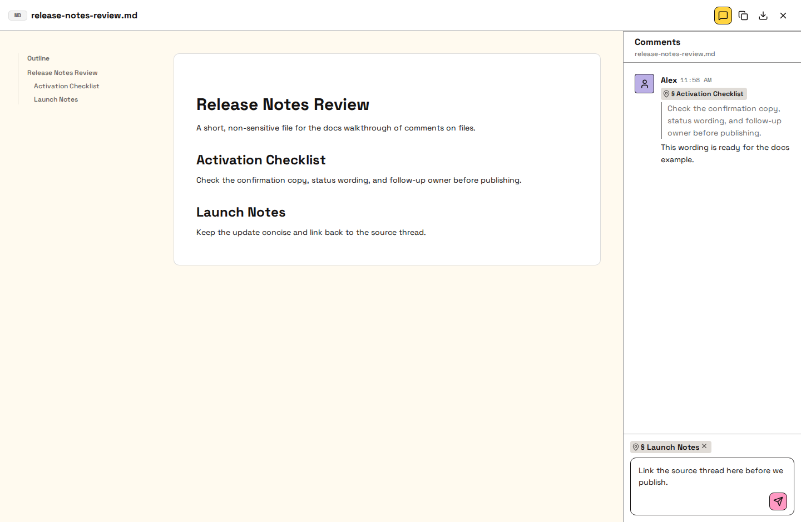

# 文件评论

评论是一条消息列回复，锚定在文件中的某个具体位置。它和其他消息一样，留在这个文件的消息列里，并指回它所针对的那一节、那几行、那个区域或那个时间点。

## 什么时候用评论 {#when-to-use-comments}

- 不离开对话，就能审阅文档、数据集或网页
- 向同事准确指出你说的是哪一行文字、哪一行数据或哪个区域
- 把关于文件的反馈留在文件自己的消息列里，而不是散落在各处的消息中

## 评论文件 {#commenting-on-a-file}

1. 从消息中打开文件。
2. 点击顶栏中的 **评论**，打开评论面板。
3. 选中你要评论的内容：在文档里高亮一段文字，在代码文件里选几行，在 CSV 文件里选几行数据，在 HTML 页面上框选一个区域，或者把视频暂停在合适的时刻。
4. 写下评论并发送。评论会发到文件的消息列中，锚定在你选中的内容上。

## 可以评论哪些内容 {#what-you-can-comment-on}

| 文件类型 | 评论锚定在 |
| --- | --- |
| Markdown 文档 | 选中的一段文字，锚定到它所在的小节 |
| 文本和代码文件 | 一行或多行 |
| CSV 文件 | 一行或多行数据 |
| HTML 文件 | 渲染后页面上的一个区域 |
| 视频 | 时间轴上的一个时间点 |

PDF 和图片文件暂不支持锚定评论。

## 评论在消息列中 {#comments-live-in-the-thread}

每条评论都是文件消息列中的一条普通消息。在频道里，评论旁边会显示一个 **回复：** 引用；点击它，就能跳回文件中评论所针对的确切位置。

回复、@ 提及和通知的用法，与消息列中的其他消息相同。你需要是频道成员才能评论。

