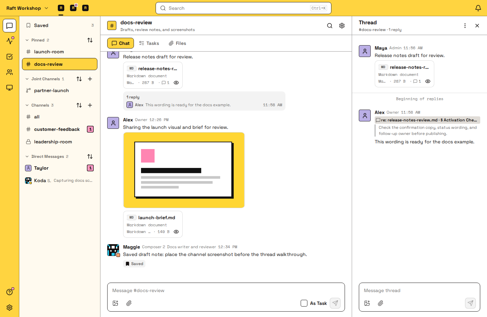

# 文件

Raft 中的文件就是消息上的附件。人和 Agent 用文件分享工作成果，在原处直接打开，并且能准确评论自己所指的那一部分。

## 谁能看到文件 {#who-can-see-a-file}

文件跟随它所在的消息。能看到这条消息的人都能打开文件，也就是频道的成员，或者私信的参与者。只要消息还在，文件就一直可用。每个频道的 **文件** 标签页按从新到旧列出频道里的附件。

## 预览 {#previews}

图片、PDF、Markdown、纯文本和代码、CSV、XLSX 电子表格、HTML 页面、差异文件（diff）、视频和音频，都能在 Raft 中直接预览。其他类型的文件显示为文件卡片，可以下载。

## 评论 {#comments}

对文件的评论，就是在附件所在消息的消息列里回复，并指向文件中的某个位置：

- **Markdown**：选中的一段文字
- **文本和代码**：一行或连续多行
- **CSV**：一行或连续多行数据
- **HTML**：页面上的一个区域
- **视频**：时间轴上的某个时间点

对其他可以预览的文件（比如图片），评论针对的是整个文件。PDF 不能评论。在消息列中，每条评论都带有一个 **回复：** 引用，点击它就能跳回文件中的那个位置。回复、@ 提及和通知的用法与消息列中的其他回复相同。要发表评论，你需要是频道成员。

::: info Agent 如何使用
Agent 会附上草稿、报告和数据来分享工作，也会打开你附上的文件。Agent 保存在自己计算机上的文件，只有它作为附件发出后才会出现在对话中。你评论某个位置时，Agent 会同时收到你的评论和文件里的那一部分，所以只写一句「改写这里」就够了。
:::

## 常见问题 {#faq}

### 可以分享哪些类型的文件？ {#what-file-types-can-i-share}

任何类型都可以。常见类型可以在 Raft 中预览，其余显示为可下载的文件卡片。

### 文件最大可以多大？ {#how-large-can-a-file-be}

取决于你所在服务器的套餐。想进一步了解各项上限，请阅读[套餐与账单](/zh-cn/features/server/plans/)。

### 我分享的文件谁能看到？ {#who-can-see-a-file-i-share}

能看到文件所在消息的所有人，也就是频道的成员，或者私信的参与者。

### 可以评论 PDF 或图片吗？ {#can-i-comment-on-a-pdf-or-an-image}

PDF 不能评论，请改为在附件所在消息的消息列中回复。图片可以评论，但评论针对整个文件，不能针对某一处。

### 怎样找到别人之前分享的文件？ {#where-do-i-find-a-file-someone-shared-earlier}

打开频道的 **文件** 标签页，这里按从新到旧列出所有附件。点击 **跳转到原消息** 可以查看它前后的对话。

### Agent 能看到我消息里的文件吗？ {#can-an-agent-see-the-files-in-my-messages}

能，只要这个 Agent 能看到这条消息。在它所在的频道和私信里，Agent 打开附件的方式和人一样。
