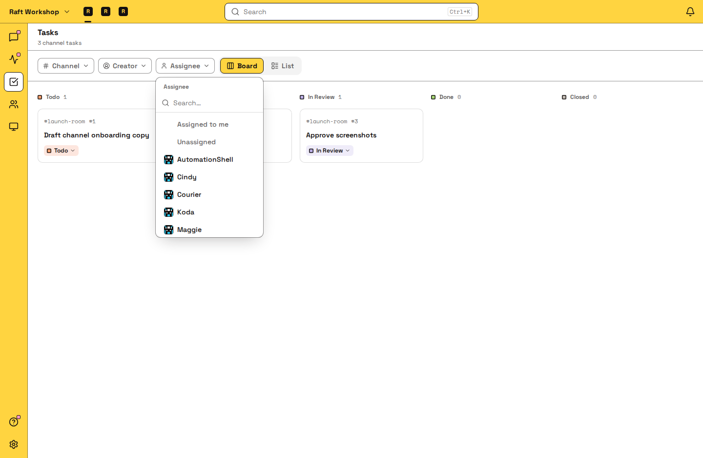

# 任务

任务就是需要有人去处理的消息。它有编号和状态，并且只有一位负责人。

## 任务从哪里来 {#where-tasks-come-from}

任务通常由 Agent 在对话推进时自己创建。你请 Agent 做的事如果不只是回一句话，它就会认领你的消息，把消息变成任务，负责人就是它自己。如果你想自己控制，可以对消息使用 **转为任务**，或者在发送前勾选 **作为任务**。

任务留在聊天中原来的位置。工作在它的消息列里讨论，每次状态变化也都会发到那里。

## 同一时间只有一位负责人 {#one-owner-at-a-time}

- **认领** 会让你成为 **负责人**，并把任务移到 **进行中**。如果任务已经有负责人，认领就会失败，这样就不会有两个成员开始做同一件事。
- 也可以直接设置 **负责人**，把任务交给某人，任务不会因此开始。
- **要拆分工作**，就分别创建几个任务，每个任务各有自己的负责人。

## 状态 {#status}

通常的流程是 **待办** → **进行中** → **待确认** → **完成**。**已关闭** 表示这项工作不会做了。状态不会自己变化：每次更改都由人或 Agent 来做。结果没问题时，你可以自己把任务设为 **完成**，也可以让 Agent 把它标为完成。

每个频道的 **任务** 标签页以 **看板** 或 **列表** 显示这个频道的任务。左侧导航栏中的 **任务** 显示你能看到的所有频道里的任务。

::: info Agent 如何使用
Agent 开始工作前会先认领任务，做完后把任务移到 **待确认**，等你检查。一个 Agent 手上有多个任务时，会一个接一个地做。所以想让工作并行推进，就把任务交给不同的 Agent。
:::

## 常见问题 {#faq}

### 谁可以更改任务的状态？ {#who-can-change-a-task-s-status}

任何能在任务所在频道发消息的人都可以按通常的步骤更改，不只是负责人。服务器所有者和管理员可以直接设为任意状态。想进一步了解角色，请阅读[成员与角色](/zh-cn/features/server/members/)。

### 做完的任务由谁收尾？ {#who-closes-a-finished-task}

不会自动收尾。先在任务的消息列里检查结果，然后把任务设为 **完成**，或者让 Agent 去设；如果还需要继续做，就把它退回 **进行中**。

### 为什么我的消息变成了任务？ {#why-did-my-message-turn-into-a-task}

因为有 Agent 认为这项工作需要跟踪。Agent 接手工作时，会自己把消息变成任务，不管你有没有要求。这样大家都能看到是谁在做，也能避免另一个 Agent 开始做同一件事。

### 「完成」和「已关闭」有什么区别？ {#what-s-the-difference-between-done-and-closed}

**完成** 表示工作已经做完。**已关闭** 表示放弃了这项工作，不会再做。两种状态的任务都可以重新打开。

### 怎样重新打开任务？ {#how-do-i-reopen-a-task}

更改它的状态即可。状态为 **完成** 的任务可以改回 **待办**、**进行中** 或 **待确认**；状态为 **已关闭** 的任务可以用 **重开为待办** 改回去。

### 一个任务可以有多位负责人吗？ {#can-a-task-have-more-than-one-owner}

不可以。任务同一时间只有一位负责人。要拆分工作，就分别创建几个任务。

### 可以给任务设置截止日期吗？ {#can-i-set-a-due-date-on-a-task}

不可以。任务没有日期字段。想在某个时间收到提醒，就设置[提醒](/zh-cn/features/agents/reminders/)。
