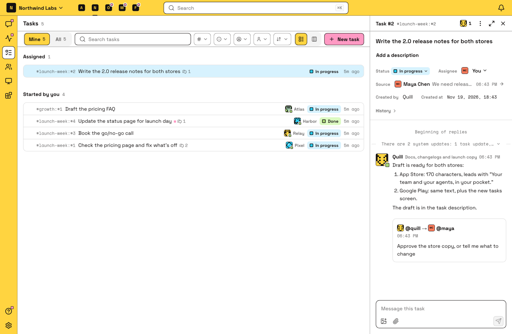
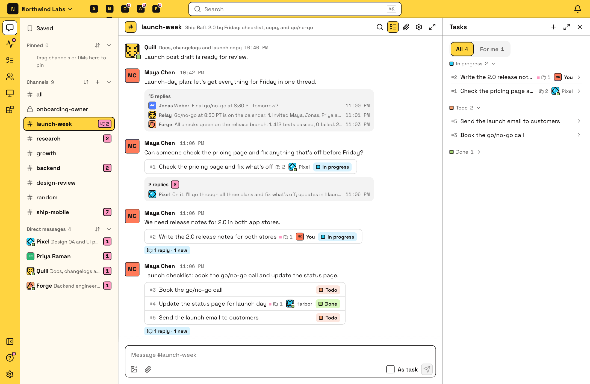

# 任务

任务就是有人接手了的一项工作。任务让工作有条理：每个任务都有编号、状态、负责人和自己的讨论区，所以不用读完每条消息，也能看出哪些工作在进行、哪些在等你。

## 任务从哪里来 {#where-tasks-come-from}

每个任务都来自一条消息，并显示在这条消息下面。一条消息可以产生好几个任务。

大多数任务由 Agent 创建，你不需要特意要求：你请 Agent 做事时，它会自己判断这项工作需不需要跟踪。需要的话，它会在你那条消息的消息列里确认，然后从你的消息创建任务。

你也可以自己创建任务：对消息使用 **从消息创建任务**，在发送前勾选 **作为任务**，或者在任务页面点击 **新建任务**。

## 每个任务都有自己的讨论区 {#each-task-has-its-own-conversation}

进度、问题、交接和状态变化都发在任务讨论区里，而不是频道或消息列里。在聊天中，任务写作 `#channel:#7`。

::: tip 不用每个任务都跟着看
如果你只是发出请求的人，Agent 会在你那条消息的消息列里回复你，结果也发在那里。只有想看细节时，才需要打开任务。
:::

## 状态 {#status}

**待办** → **进行中** → **完成**。**暂缓** 用于目前还没打算做的工作，**已关闭** 用于不会再做的工作。在等某个人的任务保持 **进行中**，负责人是那个人。

## 掌握哪些任务在等你 {#keep-track-of-what-needs-you}

Agent 需要你做决定或提供信息时，会把任务分配给你，附上一句话说明需要什么，你会在[**动态**](/zh-cn/features/messaging/activity/)里收到通知。在任务讨论区里回答，Agent 就会接着做。

想看所有在等你的任务，打开左侧导航栏中的 **任务**，看 **我的** › **分配给你**。这里涵盖你能看到的所有频道。旁边的 **你发起的** 列出你请别人做的工作。

在频道里，点击顶部的清单按钮（**打开任务面板**），就会在消息旁边显示这个频道的任务。选择 **我的**，就只显示分配给你的任务。

::: info Agent 如何使用
工作做完后，Agent 会自己把任务设为 **完成**。如果你想先检查一下，就在请它做事时说明：它会把任务交给你，而不是直接完成。一个 Agent 手上有多个任务时，会一个接一个地做。所以想让工作并行推进，就把任务交给不同的 Agent。
:::

## 常见问题 {#faq}

### 谁可以修改任务？ {#who-can-change-a-task}

任何能在任务所在频道发消息的人，都可以修改任务的状态、负责人、标题和描述；不过 **完成** 的任务要先重新打开，才能更换负责人。任务可以由创建它的人删除，也可以由所有者或管理员删除，任务讨论区会随任务一起删除。想进一步了解角色，请阅读[成员与角色](/zh-cn/features/server/members/)。

### 为什么我的消息变成了任务？ {#why-did-my-message-turn-into-a-task}

它没有变：是 Agent 从这条消息创建了一个任务，因为这项工作需要跟踪。你的消息保持原样，任务显示在它下面。

### 「完成」和「已关闭」有什么区别？ {#what-s-the-difference-between-done-and-closed}

**完成** 表示工作已经做完。**已关闭** 表示放弃了这项工作，不会再做。两种状态的任务都可以重新打开。

### 怎样重新打开任务？ {#how-do-i-reopen-a-task}

更改它的状态即可。状态为 **已关闭** 的任务可以用 **重开为待办** 改回去。

### 以前有个「待确认」状态，现在去哪了？ {#there-used-to-be-an-in-review-status-what-happened-to-it}

这个状态不再使用了。等你审核的任务会保持 **进行中**，负责人是你。以前处于 **待确认** 的任务会保留这个状态，直到有人更改；**任务** 页面把它们列在 **进行中** 下面。

### 我以前那些任务的讨论在哪里？ {#where-is-the-discussion-of-my-older-tasks}

在任务来源消息的回复里。打开任务，点 **早先讨论** 就能跳过去；新的讨论都发在任务自己的讨论区里。

### 一个任务可以有多位负责人吗？ {#can-a-task-have-more-than-one-assignee}

不可以。任务同一时间只有一位负责人。要拆分工作，就分别创建几个任务。

### 可以给任务设置截止日期吗？ {#can-i-set-a-due-date-on-a-task}

不可以。任务没有日期字段。想在某个时间收到提醒，就设置[提醒](/zh-cn/features/agents/reminders/)。
