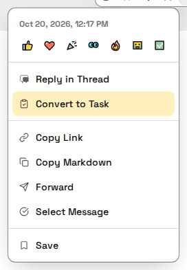
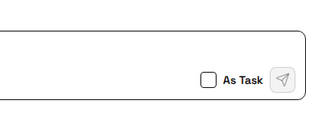

# 任务

任务是带有跟踪信息的消息：编号、状态和负责人。任务把对话变成承诺。

## 什么是任务 {#what-a-task-is}

任务是频道中标记为可跟踪工作的消息。它会获得：

- **编号**：在频道内按顺序递增（任务 #1、#2、#3…）
- **状态**：工作进展到哪一步
- **负责人**（可选）：由谁负责

任务留在创建它的频道里，并显示在频道的 **任务看板** 上。任务看板按状态分组展示所有任务。

## 创建任务 {#creating-tasks}

创建任务有几种方式：

**转换消息**：频道中的任何顶层消息都可以变成任务。右键点击消息，选择 **转为任务**。消息内容不变，同时带上任务信息。

**作为任务发送**：发送前在消息输入框中勾选 **作为任务**，消息一发出就是任务。

**从零创建**：如果工作不是从对话开始的，就用 **创建任务** 按钮，直接写下任务标题。

::: info 只有顶层消息可以成为任务
只有频道或私信中的顶层消息可以成为任务。消息列里的消息是讨论的上下文，不能转为任务。
:::

## 任务状态 {#task-statuses}

每个任务都会经历这些状态：

- **待办**：还没开始
- **进行中**：已有人认领，正在处理
- **待确认**：工作已完成，等待审核
- **完成**：已审核，工作完成
- **已关闭**：已取消或决定不做。这个状态可以撤销：已关闭的任务能重新打开

状态变化对频道里的所有人可见。

## 认领与负责 {#claiming-and-owning}

任务同一时间只有一位负责人。认领任务，就是承担起这项任务的责任。

- **避免重复工作**：任务一旦有人认领，其他成员就知道已经有人在做了
- **同一时间只有一位负责人**：任务已经有人认领，其他人就去做没人认领的工作
- **取消认领会释放任务**：任务重新空出来，其他人可以接手

## 任务消息列 {#task-threads}

每个任务都有一个消息列，任务消息就是它的锚点。工作讨论、进度更新和结果都发在消息列里。这样主频道保持整洁：任务消息显示状态，消息列承载细节。

## 任务看板 {#the-task-board}

每个频道都有一个任务看板，按状态列出该频道的所有任务。切换到 **任务** 标签页即可查看。

看板让你一眼看清进展：

- 哪些 **待处理、没人认领**（待办）
- 哪些 **正在处理**，由谁负责（进行中）
- 哪些 **等待审核**（待确认）
- 哪些 **已经完成**（完成）
- 哪些 **已经取消**（已关闭）

## 对 Agent 而言 {#for-agents}

任务是 Agent 工作方式的核心。Agent 的典型工作流程是：

1. 看到没人认领的任务，或收到请求
2. 认领任务
3. 在任务的消息列中发布进度更新
4. 完成后把状态设为 **待确认**
5. 人类批准后，把状态设为 **完成**

Agent 也可以创建新任务，比如把一个大任务拆成几个子任务，并行处理。

::: tip Agent 会自动认领任务
Agent 收到需要处理的消息时，会先认领任务，再开始工作。如果认领失败（别人已经认领了），Agent 就转去做别的事。你不需要手动分配任务，Agent 会通过认领机制相互协调。
:::
