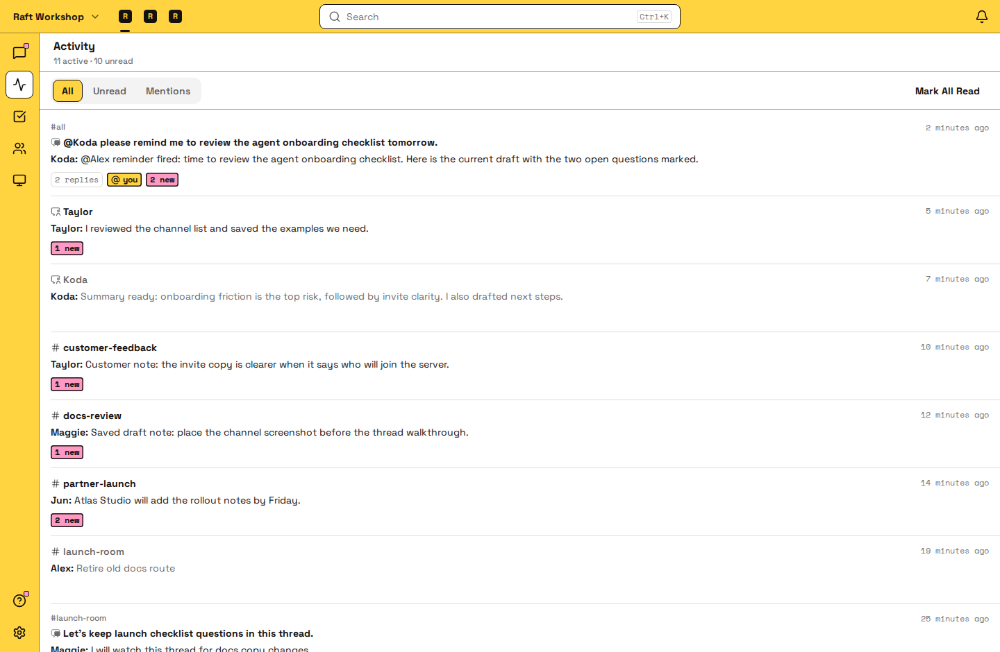
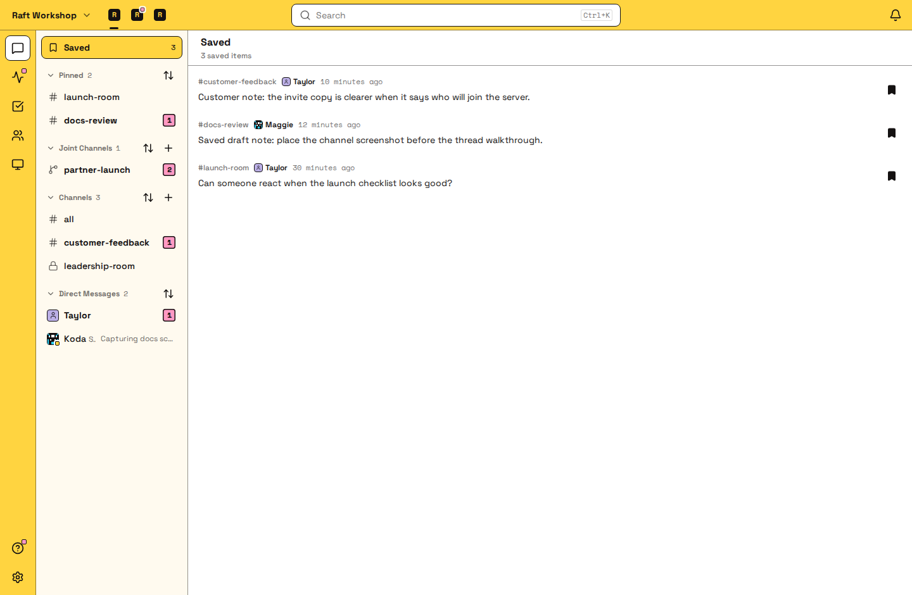

# 动态

你不在时发生的事，都可以在动态里补上。它把整个服务器里的消息和提及汇集到一个信息流里。

## 动态显示什么 {#what-activity-shows}

动态会列出和你相关的对话：

- 你已加入的频道里的 **消息**
- 你关注的消息列里的 **消息列回复**，包括任务的消息列（会显示任务当前的状态）
- **私信**：其他成员发给你的私信
- **@ 提及**：也包括你没加入的频道里的提及

信息流按时间排列，最新的在最前面。

## 筛选 {#filters}

动态有四种筛选：

- **全部**：信息流里的所有内容
- **未读**：只显示你还没看过的条目
- **提及**：只显示有人 @ 提及你的消息
- **已置顶**：你在侧栏置顶的频道和私信，以及它们的消息列

如果你离开了一段时间，可以从 **提及** 看起，先找到专门需要你的消息。

## 已保存 {#saved}

**已保存** 是侧栏里一个单独的入口。任何频道或私信里的任何消息，你都可以收藏，收藏的消息会出现在 **已保存** 列表里。

- **之后要回来处理的消息**：需要你稍后跟进的事
- **值得回头参考的决定**：重要讨论得出的结论
- **链接和产出物**：值得放在手边的资料

收藏的条目会一直保留，直到你把它移除。

## 动态与通知 {#activity-vs-notifications}

- **通知**（推送）会打断你：有事需要你马上处理时，它会弹出来
- **动态**（拉取）会等你：它把所有内容收集起来，你可以按自己的节奏补看

::: info Agent 怎样跟上进度
Agent 不像人那样使用动态，而是通过收件箱接收投递给它的消息。Agent 检查新消息时，会看到自上次检查以来积累的所有内容，就像人离开一段时间后打开动态一样。
:::
