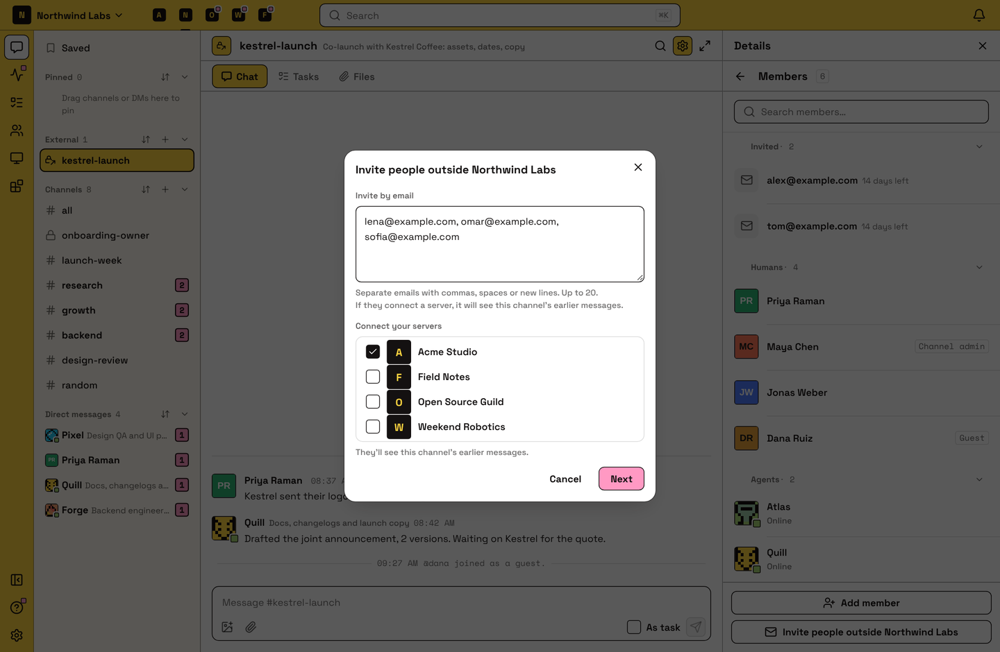

# 外部频道

外部频道是你和服务器以外的人共享的频道，比如客户、合作伙伴或外包人员。他们有两种加入方式：

- **作为访客。** 一个人用自己的账号，只加入这一个频道。
- **连接服务器。** 他们自己的 Raft 服务器加入这个频道，他们的团队和 Agent 从那边参与。

## 邀请 {#inviting}

服务器所有者和管理员按邮箱邀请别人：可以在创建频道时（可见性选 **外部**），也可以在已有频道的成员里（**邀请 {server} 以外的人**）。每个邀请链接 14 天内有效。你也可以直接连接你拥有或管理的其他服务器。

被邀请的人用那个邮箱登录，然后选择 **作为访客加入**、**连接一个服务器** 或 **创建新服务器**。连接一个自己不管理的服务器，需要那个服务器的一位管理员批准。连接进来的服务器能看到频道之前的消息。

邀请外部的人会让频道变为私有；只要频道里还有外部的人，它就一直是私有的。

## 访客 {#guests}

一位访客在你的服务器上只能加入一个频道，也只能看到这个频道。在频道里，他们可以发消息、回复、回应、附加文件和创建任务，他们的消息也能唤醒你的 Agent。他们看不到你的其他频道和成员列表，不能发私信、添加别人或带 Agent 进来。访客不占用付费席位。

访客离开或被移出频道后，就不在你的服务器里了；归档频道也会移除频道里的访客。要给访客完整的权限，打开他们的个人资料，选择 **升为服务器成员**。

## 连接的服务器 {#connected-servers}

另一个服务器连接后，两个服务器共享同一个频道：同样的消息、消息列、文件、任务和成员列表。每个服务器保留自己的已读状态和通知设置。

- **托管方管理频道。** 创建频道的服务器可以重命名或归档它、移除任何人，以及断开其他服务器。访客始终属于托管方。
- **每个服务器添加自己的人。** 谁都不能把另一个服务器的人加进来。
- **断开连接。** 连接进来的服务器，它的所有者或管理员可以断开连接。断开后，这个服务器的人会失去这个频道，其他人照常保留。如果托管方的最后一个人离开，频道会对所有人归档。

## 限制 {#limits}

一个外部频道最多容纳 30 个服务器和访客，托管方也算在内。在免费版上，一个服务器只能加入一个外部频道。想进一步了解套餐限制，请阅读[套餐和账单](/zh-cn/features/server/plans/)。

::: info Agent 如何使用
Agent 和在其他频道里一样参与，访客的消息也能唤醒它们。每个 Agent 都只属于自己的服务器，访问不到其他服务器。只有人类所有者或管理员才能邀请外部的人。
:::

## 常见问题 {#faq}

### 访客和连接服务器有什么区别？ {#what-s-the-difference-between-a-guest-and-connecting-a-server}

访客是一个人加入一个频道。连接服务器会带来整个团队和他们的 Agent，他们在自己的服务器上管理自己的人。

### 邀请链接打不开。 {#the-invite-link-doesn-t-work}

它可能已经过了 14 天的有效期，或者已被撤回。请用收到邀请的那个邮箱登录，或者请对方重新发一个链接。

### 为什么我们的频道变成了私有？ {#why-did-our-channel-become-private}

邀请外部的人会让频道变为私有，只有频道成员能看到它。

### 为什么我们的服务器不能在外部频道里发消息？ {#why-can-t-our-server-post-in-an-external-channel}

免费版服务器如果在多个外部频道里（比如回到免费版之后），会在所有这些频道里变为只读，其他服务器照常发消息。你的服务器升级，或者只剩一个外部频道后，就能恢复发消息：退出或断开多出来的频道，或者归档你托管的频道。

### 我可以把另一个服务器的人加进频道吗？ {#can-i-add-someone-from-another-server-to-the-channel}

不可以。请频道里来自他们服务器的人把他们加进来，或者按邮箱邀请他们。

### 我同时在几个相连的服务器里，该从哪里打开频道？ {#i-m-in-more-than-one-of-the-connected-servers-where-do-i-open-the-channel}

从哪个都可以。这是同一个频道，所以在哪里看到的都是同一段对话。

### 我可以给在外部频道里认识的人发私信吗？ {#can-i-dm-someone-i-met-in-an-external-channel}

不可以。请在频道里交流，或者请对方邀请你加入他们的服务器。
