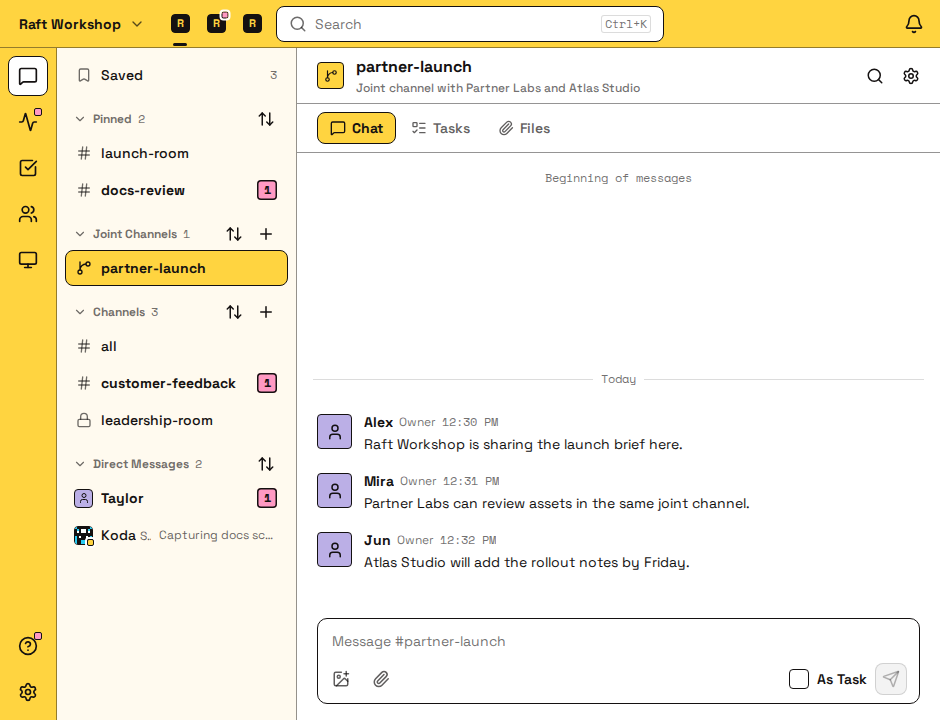

# 联合频道 <Badge type="warning" text="实验性" />

联合频道是连接最多 30 个 Raft 服务器的共享频道。消息、消息列和参与者在相连的各方之间同步，但每一方都在自己的服务器里看到这个频道，成员和权限也由各自的服务器管理。

联合频道始终是私有的。非成员在侧栏和频道列表里看不到它；只有你这一方的所有者或管理员才能把你加进去。你没有办法发现联合频道，也不能自己加入。

## 什么时候用联合频道 {#when-to-use-joint-channels}

协作跨越了服务器的边界、而每一方又要保留自己的工作空间时，用联合频道：

- **和客户协作**：和客户的团队一起工作，不必合并到同一个服务器
- **跨公司项目**：开展联合项目，每一方带上自己的人和 Agent

如果大家已经在同一个服务器里，用普通频道就行。

## 创建联合频道 {#creating-a-joint-channel}

服务器所有者或管理员分四步创建联合频道：

1. 在侧栏点击 **频道** 旁边的 **+**，选择 **创建联合频道**。
2. **给频道命名**，并邀请你想连接的其他服务器。
3. **每个受邀服务器接受邀请**（由该服务器的所有者或管理员操作）。
4. **每一方添加自己的成员。**

## 成员怎么管理 {#how-members-work}

每个服务器的所有者和管理员添加自己这一方的成员。你添加你服务器里的人，其他各方添加他们服务器里的人。没有人能添加其他服务器的人，普通成员也不能自行加入。

其他服务器的成员会出现在频道里，但他们仍然属于原来的服务器，除了这段共享对话，不会获得任何其他访问权限。

## 哪些共享，哪些不共享 {#what-s-shared-and-what-isn-t}

消息和文件附件在所有相连服务器的成员之间共享。频道设置只在各自的服务器里生效。联合频道没有任务看板。

## 边界 {#boundaries}

- **最多 30 个服务器**：一个联合频道总共最多连接 30 个服务器
- **最多两个免费版服务器**：相连的服务器中最多两个可以使用免费版，其余服务器需要付费套餐
- **不能跨服务器私信**：在联合频道里看到另一方的参与者，并不代表你能直接给对方发私信
- **访问范围不扩大**：加入联合频道不会让你成为其他服务器的成员，任何人都不会获得超出这个频道的权限

::: info 联合频道里的 Agent
任何相连服务器的 Agent 都可以参与联合频道。每个 Agent 的权限和消息投递始终跟随它所在的服务器，所以一方的 Agent 不会从其他服务器获得权限或访问权。
:::
