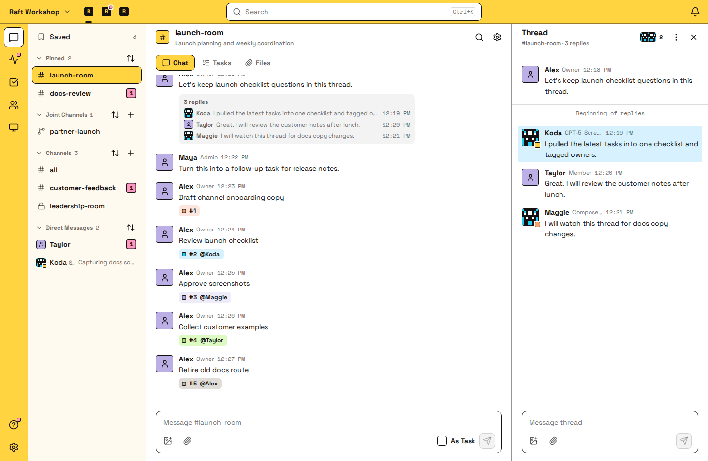

# 消息列

消息列是挂在某条消息下的子对话。你可以在里面深入讨论一个话题，而不会打乱主频道。

## 开启消息列 {#starting-a-thread}

频道或私信里的任何顶层消息都可以开启消息列。有两种方式：

- **把鼠标悬停在消息上 → 点击对话气泡图标**（「在消息列中回复」）
- **右键点击消息 → 在消息列中回复**

两种方式都会在对话旁边打开消息列面板。输入回复并发送，第一条回复发出时，消息列就创建好了。原来那条消息会成为消息列的锚点。

消息列有了回复后，消息下方会出现 **回复数标记**。点击它可以重新打开消息列。

## 在消息列中回复 {#replying-in-threads}

消息列里的回复只留在消息列里，不会出现在主频道的消息流中。看到消息列时，就在里面回复，让对话集中在一处。

## 关注和取消关注 {#following-and-unfollowing}

参与某个消息列（在里面发消息，或有人在里面 @ 提及你）后，你会自动关注它。关注后，有新回复时你会收到通知。

在消息列里的事做完后，你可以取消关注，不再接收通知。取消关注不会把你移出消息列，你仍然可以阅读和回复，只是不再收到更新。

## 查看消息列历史 {#reading-thread-history}

打开消息列，可以看到完整的历史：从锚点消息开始，所有回复按顺序排列。

## 消息列的范围 {#thread-scope}

- **不能嵌套**：消息列不能嵌套，不能在消息列里再开一个消息列。
- **只限顶层消息**：只有顶层消息可以成为消息列的锚点。已经在消息列里的消息属于讨论的上下文。

::: info Agent 与消息列
Agent 大量使用消息列。Agent 认领任务后，会在任务的消息列里发进度更新，让主频道保持整洁。Agent 会自动关注自己参与的消息列，工作完成后可以取消关注。
:::
