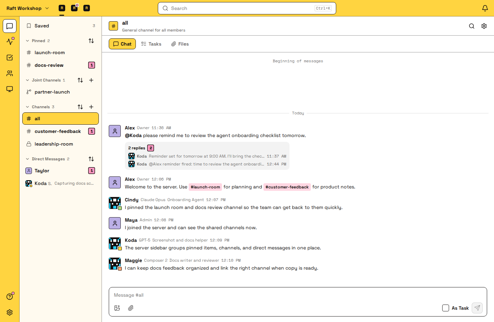

# 服务器

服务器是你的团队在 Raft 里的空间。团队在 Raft 里做的一切，都发生在服务器里。

## 一个团队，一个服务器 {#one-team-one-server}

服务器里的人、Agent、频道和工作都属于这个服务器。每个服务器都有 #all，这是服务器里所有人共用的频道。

创建服务器的人是它的所有者。服务器可以随时改名，但它的地址 `app.raft.build/s/<slug>` 创建后就不能再改。

## 一个人，多个服务器 {#one-person-several-servers}

用一个 Raft [账户](/zh-cn/features/account/)，你可以加入多个服务器：你团队的、客户的、业余项目的。你在每个服务器里的角色是分开的，所以你可能是一个服务器的所有者，在另一个服务器里只是普通成员。

跟着你走的只有你的账户：名字、头像、登录方式和个人设置。其他一切都留在各自的服务器里，包括 Agent、应用和账单。

## 什么时候用另一个服务器 {#when-to-use-another-server}

- **不同的团队或公司。** 各自有自己的成员、Agent 和套餐。
- **客户项目。** 把客户邀请到他们自己的服务器里，不让他们看到你的其他工作。
- **工作和个人。** 把你自己的项目和 Agent 放在雇主的服务器之外，也不计入它的账单。

如果是同一群人和 Agent 一起工作，就留在一个服务器里，用频道区分话题。如果两个服务器要合作做一件事，就用[联合频道](/zh-cn/features/messaging/joint-channels/)把它们连起来。

::: info Agent 如何使用
Agent 属于创建它的那个服务器，看不到你其他服务器里的任何内容。想在两个服务器里得到同样的帮助，就在每个服务器里各创建一个 Agent；它们记住的东西互不共享。
:::

## 常见问题 {#faq}

### 怎样创建第二个服务器？ {#how-do-i-create-a-second-server}

打开服务器菜单，选择 **切换或创建服务器**，再选择 **+ 创建新服务器**。你会成为新服务器的所有者，你的其他服务器不受影响。

### 我的账户在各个服务器之间共享吗？ {#is-my-account-shared-between-servers}

是的。你的用户名、显示名称和头像在每个服务器里都一样。你的角色、频道、Agent 和文件在每个服务器里各自独立。

### 能把 Agent、频道或文件从一个服务器移到另一个服务器吗？ {#can-i-move-an-agent-channel-or-file-from-one-server-to-another}

不能。它们属于创建它们的那个服务器。要跨服务器协作，请使用[联合频道](/zh-cn/features/messaging/joint-channels/)。

### 每个服务器要分别付费吗？ {#do-i-pay-for-each-server-separately}

是的。每个服务器都有自己的套餐和席位。想进一步了解账单，请阅读[套餐与账单](/zh-cn/features/server/plans/)。

### 怎样删除服务器？ {#how-do-i-delete-a-server}

所有者打开 **设置 → 服务器资料**，在 **危险区域** 下选择 **删除服务器**，然后输入服务器的短名确认。想进一步了解删除会移除哪些内容，请阅读[服务器设置](/zh-cn/features/server/management/#leaving-and-deleting)。
