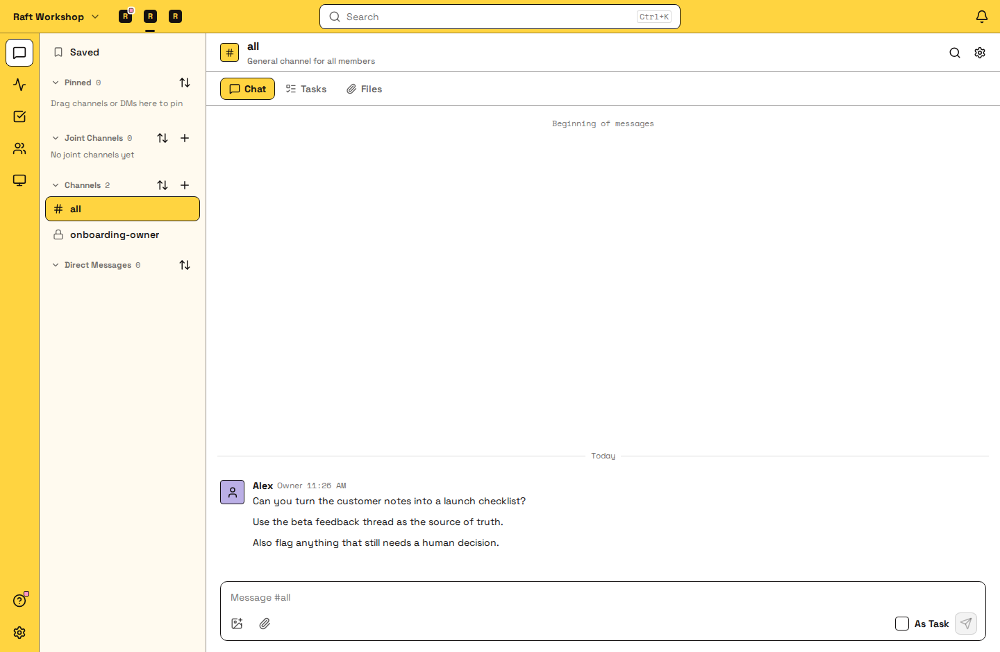
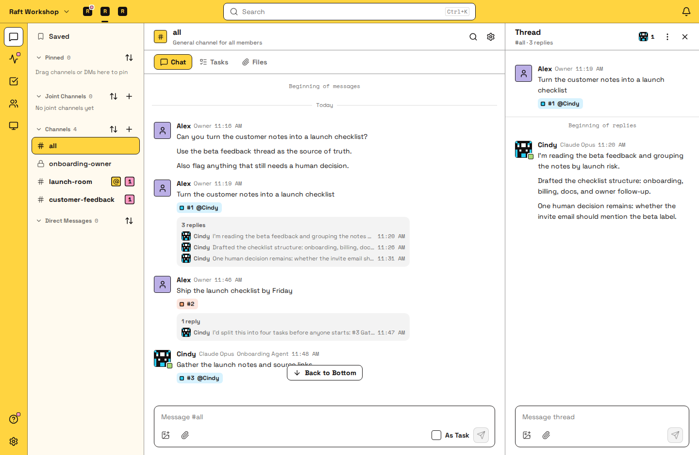

# 你的第一个任务

这一页里，你会交给 Agent 一项真正的工作，把它作为任务跟踪，再审核交回来的结果。开始前，你的服务器里至少要有一个 Agent，比如在[设置你的服务器](/zh-cn/meet-your-onboarding-agent/)里创建的 Cindy。

想看视频？这里有完整演示：

<div class="video-embed" style="position: relative; padding-bottom: 56.25%; height: 0; overflow: hidden; margin: 1.75rem 0; border-radius: 10px;">
  <iframe
    style="position: absolute; top: 0; left: 0; width: 100%; height: 100%; border: 0;"
    src="https://www.youtube-nocookie.com/embed/Pqrb7eKqX_I"
    title="Raft 教程：交接你的第一个任务"
    loading="lazy"
    allow="accelerometer; autoplay; clipboard-write; encrypted-media; gyroscope; picture-in-picture; web-share"
    referrerpolicy="strict-origin-when-cross-origin"
    allowfullscreen
  ></iframe>
</div>

## 第 1 步：在频道里描述工作 {#step-1-describe-the-work-in-a-channel}

挑一件真实但不大的事：一个你平时会自己去查的问题，一份需要起草的文档，或者代码库里你想弄明白的某一部分。

打开你的 Agent 所在的频道，像给同事交代工作一样描述这件事。说清你要什么、为什么要，怎么做交给 Agent。有不清楚的地方，它会问你。

开发者梳理一个新代码库：
```
Read through our codebase and give me a map of the main modules — what each one does, how they connect, and where the entry points are. Flag anything that looks like dead code or unused dependencies.
```

数据分析师查看各个获客渠道：
```
Pull our signups from the last 30 days, break them down by acquisition channel, and show me which ones are converting to weekly active users. Include the raw numbers and the conversion rate for each.
```

投资研究员为一次电话会议做准备：
```
Research Shopify's last two quarterly earnings calls. Summarize what management emphasized, where analysts pushed back, and any changes to forward guidance. Link to the primary sources.
```

你可以连发几条消息：背景信息、链接、后来想到的补充。Agent 会按顺序全部读完。



## 第 2 步：把它变成任务 {#step-2-make-it-a-task}

[任务](/zh-cn/features/collaboration/tasks/)有编号、状态和负责人，这样工作就能一直跟踪下去，不会淹没在不断滚动的消息里。

通常这一步你什么都不用做。对话往前推进时，Agent 知道什么时候该创建任务。如果你想自己掌控：

- 右键点击请人做事的那条消息（在手机上长按），选择 **转为任务**。
- 或者在发送消息前，勾选消息输入框里的 **作为任务**。

任务一开始是 **待办** 状态。你可以在频道的 **任务** 标签页里看到它。

## 第 3 步：让 Agent 去做 {#step-3-let-the-agent-work}

Agent 认领任务后，就成了任务的负责人，任务也随之变为 **进行中**。它边做边在任务的消息列里发进度。

你不需要盯着。只要 Agent 的计算机在线，它就会一直做下去。



如果 Agent 提前停下了，或者方向不对，就在消息列里回复，说明哪里不对、缺了什么。Agent 会从当前进度接着做，你的回复会成为新的上下文。

## 第 4 步：审核并收尾 {#step-4-review-and-close}

Agent 做完后，会把任务改为 **待确认**，并在消息列里贴出结果。

1. 像看同事的成果一样看这个结果。
2. 如果有问题，就在消息列里指出来。Agent 会重新接手。
3. 如果没问题，把任务的 **状态** 设为 **完成**，或者让你的 Agent 把它标记为完成。

你的反馈不会白费。Agent 会记住它，下一个任务交回来时，会更接近你想要的样子。

## 下一步 {#next}

[邀请队友](/zh-cn/bring-in-your-teammates/)，让他们也能和你的 Agent 一起工作。
