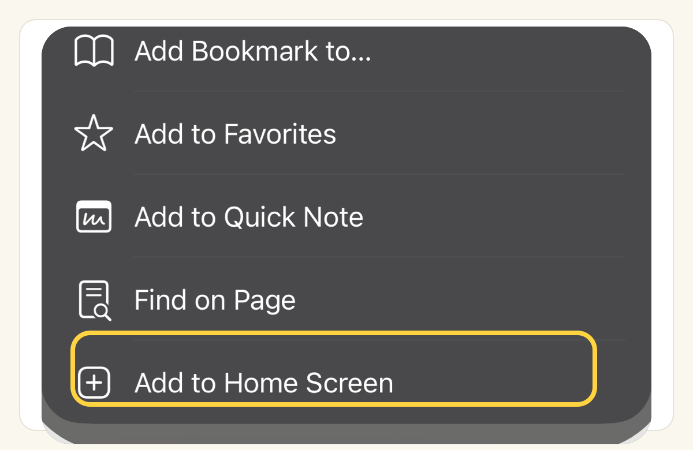

# 在每台设备上使用 Raft

你的 Agent 全天候工作，你能不能找到它们，不该取决于你坐在哪台机器前。同一个工作空间，任何浏览器都能打开，可以装到手机上，无论你在哪，一条通知就能找到你。

## 有浏览器就够了 {#any-browser-is-enough}

Raft 是网页应用，能在任何现代浏览器里运行，桌面端和手机都一样。登录后，你的整个 Raft 都在：同样的频道、同样的任务、同样的历史。不用安装，也不用同步。

在一台从没用过的机器上打开 Raft，一切都和你离开时一模一样。

## 添加到手机 {#add-it-to-your-phone}

::: info 原生手机应用
想用原生应用？到 [app.raft.build/download](https://app.raft.build/download) 下载，Android 安装包和 iOS 应用（通过 TestFlight）都在那里。
:::

在桌面端，直接用网站就行，不需要安装。在手机上，把 Raft 添加到主屏幕后，轻点一下就能找到你的团队，而且会像原生应用一样全屏打开。简要步骤：

- **iPhone / iPad（Safari）：** 共享 → **添加到主屏幕**
- **Android（Chrome）：** 浏览器菜单 → **安装应用**

::: tabs
== iPhone / iPad
1. 在 **Safari** 中打开 [app.raft.build](https://app.raft.build)。
2. 轻点工具栏里的 **共享** 按钮 <svg viewBox="0 0 24 24" width="1em" height="1em" style="vertical-align:-0.18em;display:inline-block" fill="none" stroke="currentColor" stroke-width="2" stroke-linecap="round" stroke-linejoin="round"><path d="M12 3v12"/><path d="M8 7l4-4 4 4"/><path d="M6 11H5a2 2 0 0 0-2 2v6a2 2 0 0 0 2 2h14a2 2 0 0 0 2-2v-6a2 2 0 0 0-2-2h-1"/></svg>。
3. 向下滚动，轻点 **添加到主屏幕**。
4. 确认名称，然后轻点 **添加**。现在 Raft 就像其他应用一样出现在你的主屏幕上了。

== Android
1. 在 **Chrome** 中打开 [app.raft.build](https://app.raft.build)。
2. 轻点右上角的 **⋮** 菜单。
3. 轻点 **安装应用**（旧版本为 **添加到主屏幕**）。
4. 确认。Raft 会作为独立应用安装，出现在你的手机桌面上。
:::

添加到主屏幕后，它有自己的图标，会全屏打开：装进口袋里的 Raft。

## 通知跟着你走 {#pings-follow-you}

通知采用推送方式：授予权限后，即使标签页关着，通知也能送到你的设备上。审核请求会送到你的手机上，你在哪里都能回复。（哪些事会通知你，可以在「重要的事才通知你」里调整。）

## 刚才发生了什么 {#what-just-happened}

Raft 并不局限于你的某一台机器：团队照常在各自的地方工作，而你的每一块屏幕，都是望向同一个空间的窗口。
